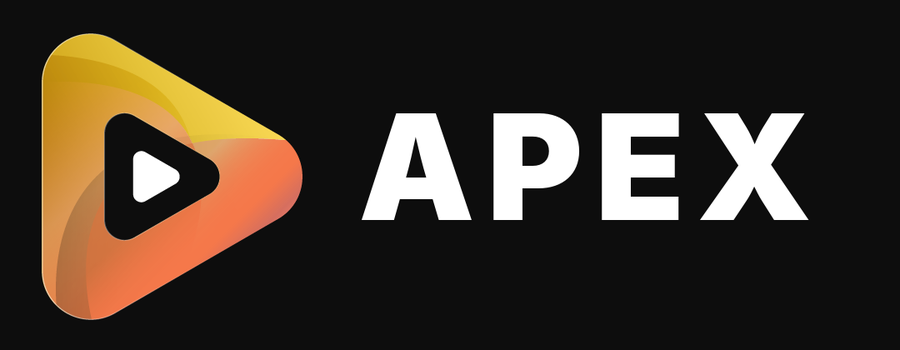

### A personal build of [NuvioTV](https://github.com/NuvioMedia/NuvioTV) for Android TV

Stock Nuvio, plus a better network engine, lossless audio, Dolby Vision handling and a detailed playback stats overlay.

---

Apex looks and behaves like stock Nuvio on your TV. It has its own name, icon, logo and package (`com.nuvioapex.tv`), so it installs next to the original and is easy to tell apart.

## What Apex adds

| | |
|---|---|
| **Network engine** | Automatic speed-up, parallel connections and adjustable chunk size, for steadier throughput on slow or uneven servers. |
| **Buffer and Network page** | Stock's Minimum and Maximum buffer settings, with memory-aware sizing, plus the network engine's Automatic speed-up and connection controls. |
| **Low-buffer rescue** | Your Minimum buffer is a real floor: when playback drops under it, or is about to run dry at its current pace, Automatic speed-up refills as fast as the server and memory allow. |
| **Fast, steady start** | Automatic speed-up opens on 2 to 3 downloads so the first seconds fill quickly, then holds the fewest downloads that carry the film with 30 % headroom, measured on your line. |
| **Lossless audio** | A lossless audio output path. |
| **Dolby Vision** | Profile 7 handling, including conversion for displays that need it. |
| **Playback stats overlay** | Detailed live stats, opened from the analytics icon in the player. |

Everything else is stock Nuvio, kept as close to upstream as possible. Every stock file that Apex changes is listed, with the reason, in [PATCHES.md](PATCHES.md), and a check in CI fails if anything else drifts.

## Install and update

1. Download `app-full-armeabi-v7a-release.apk` from the [latest release](https://github.com/LaniBoat14/nuvio-apex/releases/latest) and install it. The build is for 32-bit ARM TVs (`armeabi-v7a`).
2. After that, updates arrive inside the app: **Settings → About → check for updates**. They install over the app and keep your settings.

Apex is a separate app from Nuvio, so an existing Nuvio install is not touched. **About** also shows which Nuvio release the current Apex build is based on.

## Credits

Apex stands on other people's work, and this project would not exist without it.

- **[NuvioTV](https://github.com/NuvioMedia/NuvioTV)** by the NuvioMedia maintainers and contributors. Apex is built directly on it, and everything not listed above is theirs.
- **[Nuvio Arc](https://github.com/ysosrs123/NuvioTV-Fork)** by ysosrs123, a fork of NuvioTV. The network engine, buffer and memory handling, lossless audio path, Dolby Vision handling and stats overlay are ported from Arc.

All upstream copyright notices, licence headers and author attributions are kept. Thank you to everyone involved.

## Licence

Apex is licensed under the [GNU General Public License v3.0](LICENSE), the same as NuvioTV and Nuvio Arc. The complete source for every release is in this repository.

Apex is an independent, unofficial build. It is not affiliated with or endorsed by NuvioMedia or the Arc author. Nuvio does not provide or host any content, and neither does Apex: you bring your own sources.

## Building and staying current

Apex keeps stock Nuvio on a `stock` branch and carries its own changes on top, so a new Nuvio release is merged in rather than copied over. See [PATCHES.md](PATCHES.md) for the full list of changes and `apex/apex_purity.py` for the check that keeps that list honest.
